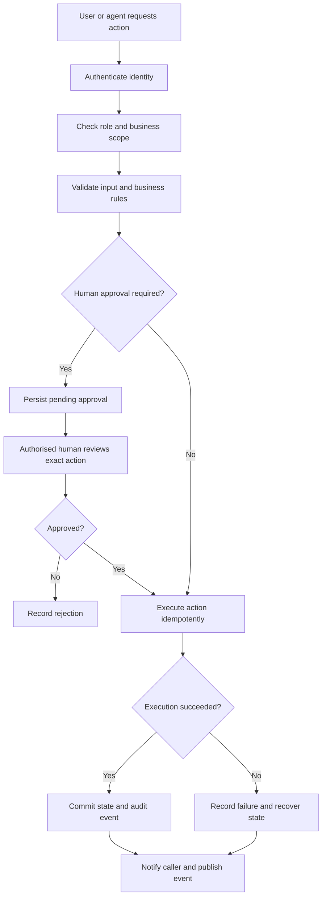
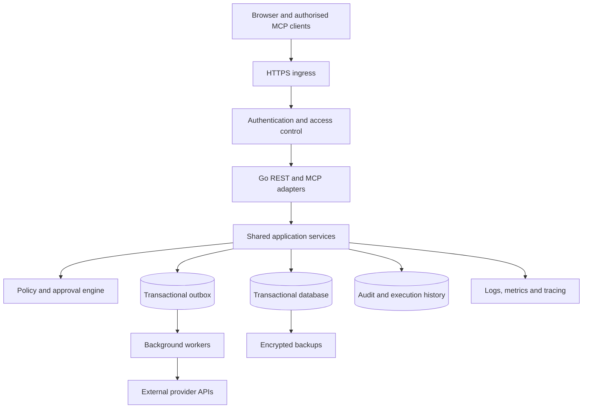

# AOSphere BOS — Production-Readiness Master Roadmap

To turn AOSphere from a working BOS prototype into a real production-level application, you need to do more than fix bugs or add features. You need to make it secure, financially reliable, recoverable, testable, scalable and trustworthy enough to operate a real business with AI agents.

The recommended path is to keep the existing **Go + SQLite + JavaScript** architecture for the initial hardening phase. Don't rebuild everything or introduce microservices before the current business workflows are reliable.

The roadmap below is organised into implementation phases, with concrete actions to turn into development sprints.

---

## Production-Readiness Roadmap Sequence

> **Recommended sequence**: Complete the gates in order rather than building every feature simultaneously.

| Phase | Title | Focus Area |
| :--- | :--- | :--- |
| **01** | **Stabilise the codebase** | Canonical runtime, architecture documentation, reproducible builds, config system. |
| **02** | **Secure the application** | Authentication, authorization (RBAC), sessions, secrets, network boundaries. |
| **03** | **Protect business operations** | Approvals, validation, transactions, idempotency, and auditability. |
| **04** | **Make data trustworthy** | Double-entry ledger, migrations, integrity constraints, backups, and recovery. |
| **05** | **Build a reliable agent platform** | MCP permissions, tool contracts, execution tracking, and guardrails. |
| **06** | **Finish product workflows** | Complete UI states, error handling, external integrations, and user management. |
| **07** | **Test and observe everything** | Automated testing, CI/CD, structured logs, metrics, alerts, and security checks. |
| **08** | **Deploy and operate** | Production infrastructure, incident response, restore drills, and release gates. |
| **09** | **Launch readiness** | Threat modeling, penetration testing, compliance, SLA/SLO definition. |

---

## Phase 1 — Stabilise the Codebase

**Goal:** Establish one predictable application that every developer can build, test, and run.

### Implementation Checklist (10/10)
- [x] **Choose Go as canonical runtime**: Formally adopt Go as the single production runtime and deprecate or re-purpose `aosphere_server.py`.
- [x] **Resolve runtime discrepancies**: Synchronize any features present in Python into Go, eliminating divergence.
- [x] **Pin Go toolchain & dependencies**: Lock supported Go version (e.g. Go 1.22+ / 1.23) and ensure `go.mod` / `go.sum` reproducibility.
- [x] **Define deployment targets & setup**: Document Windows, Linux, and macOS local development and production targets.
- [x] **Document architecture**: Environment variables, database locations, API routes, and MCP transports (Stdio & SSE).
- [x] **Unified configuration system**: Implement clean config management (flags + environment variables + defaults) for dev, test, and prod.
- [x] **Separate demo/seed data**: Prevent production startup from reseeding demo records; provide explicit seed commands.
- [x] **Consistent error handling & logging**: Add structured JSON logging (slog), unique request IDs, and `/healthz` / `/readyz` endpoints.
- [x] **Versioned API contracts**: Define `/api/v1` routes and backwards-compatibility rules.
- [x] **Coding standards & CI baseline**: Establish linters (`golangci-lint`), automated test pipelines, and PR checks.

> **Exit Gate**: A new developer can clone the repository, configure it, run automated tests, and start the application using documented commands.

---

## Phase 2 — Build Real Security

**Goal:** Nobody can access business information or perform actions merely by knowing an endpoint or guessing an ID.

### Security Checklist (13/13)
- [x] Implement user registration, login, logout, account recovery, and secure session management.
- [x] Choose an identity provider or implement reviewed authentication (avoid custom cryptography).
- [x] Add role-based access control (RBAC) for Owner, Admin, Finance, Operations, HR, Employee, and Read-Only.
- [x] Add multi-tenant / business-entity isolation to all records and database queries.
- [x] Enforce permissions strictly in the backend, not just in UI presentation.
- [x] Authenticate MCP clients and apply granular permissions per tool.
- [x] Protect approvals, payroll, financial entries, and inventory movements with explicit high-impact permissions.
- [x] Configure HTTPS/TLS, secure HTTP-only cookies, strict CORS, CSRF defense, and safe binding addresses.
- [x] Validate all inputs: request size limits, rate limits, timeouts, and pagination controls.
- [x] Store secrets in environment-specific secret stores; zero credentials in git.
- [x] Implement secure password/passkey handling via standard hashing (Argon2id/bcrypt).
- [x] Add account revocation, session expiration, suspicious-login alerts, and audit logging.
- [x] Define privacy policies, data retention, export, and deletion workflows.

> **Exit Gate**: Unauthenticated and unauthorised requests are rejected by the backend, and automated tests prove tenant isolation.

---

## Phase 3 — Make Business Workflows Safe and Transactional

**Goal:** AOSphere must never report that an action succeeded when the actual business operation failed.

### Action Execution Lifecycle



### Workflow Checklist (16/16)
- [x] Create a central application-service layer used identically by REST endpoints and MCP tools.
- [x] Implement one central policy engine for financial thresholds, approvals, roles, and prohibited actions.
- [x] Define deterministic state machines for purchase orders, invoices, deals, tasks, shifts, and approvals.
- [x] Link every approval to the exact action, payload hash, entity, and version being approved.
- [x] Implement explicit approval lifecycle states: `pending` → `approved`/`rejected` → `executing` → `completed`/`failed`.
- [x] Ensure approval decisions are atomic and conditional on remaining in `pending` state.
- [x] Add idempotency keys (`Idempotency-Key` header / parameter) to all write operations.
- [x] Explicit handling for rejection, cancellation, and error paths without orphaned side effects.
- [x] Calculate all PO totals, line items, discounts, and taxes strictly on the server.
- [x] Validate referenced entities (supplier, customer, SKU, employee) before transaction commit.
- [x] Prevent duplicate purchase orders and automatic reorders.
- [x] Enforce database transactions (`BEGIN...COMMIT`) across all multi-record writes.
- [x] Optimistic concurrency control (version checks) to prevent race conditions and lost updates.
- [x] Bounded retry policies for transient errors without duplicate external side effects.
- [x] Reconciliation background jobs detecting mismatched approvals, orders, and executions.
- [x] Clear delineation between autonomous agent actions vs. actions requiring human confirmation.

> **Exit Gate**: Every high-impact action has enforceable permissions, validated inputs, a defined state transition, durable audit trails, and a safe retry/failure path.

---

## Phase 4 — Make Data and Financial Records Trustworthy

**Goal:** The business database must remain correct under concurrent requests, crashes, and retries.

### Data & Finance Checklist (16/16)
- [x] Versioned database migrations with upgrade and rollback scripts (`internal/db/migration.go`).
- [x] Enforce foreign keys, unique constraints, check constraints, and indexes.
- [x] Tenant/business-entity ownership on every table (`org_id` scoped).
- [x] Store money in integer minor units (cents math in `internal/finance/money.go`)—never binary floating point.
- [x] Explicit currency codes, exchange rates, and half-up rounding rules.
- [x] Configurable, effective-dated tax calculation rules.
- [x] Proper double-entry general ledger with debits == credits invariant (`internal/ledger/ledger.go`).
- [x] Chart of accounts, journal entries, posting rules, accounting periods, and reversals.
- [x] Linked audit trails connecting invoices, payments, credit notes, and ledger entries.
- [x] Sequential, collision-free invoice and PO numbering (`internal/finance/sequence.go`).
- [x] Formal financial states: `draft`, `issued`, `paid`, `overdue`, `cancelled`, `reversed`.
- [x] Inventory reservations, real-time available stock, movement logs, and physical counts.
- [x] Atomic transactional outbox for event publishing (`outbox_events`).
- [x] Automated, encrypted daily backups with point-in-time recovery (`internal/backup/backup.go`).
- [x] Regular automated restore verification drills (`PRAGMA integrity_check`).
- [x] Data-at-rest encryption and strict database connection boundaries.

> **Exit Gate**: All money is represented in integer cents; every financial event posts a balanced double-entry journal entry ($\sum \text{Debits} == \sum \text{Credits}$); sequential IDs never collide; backups are taken online and verified without human intervention.

---

## Phase 5 — Turn MCP into a Reliable Agent Platform

**Goal:** Agents should be capable of useful work without being able to bypass the BOS's business rules.

### Agent Platform Checklist (15/15)
- [x] Comprehensive MCP registry detailing tools, resources, prompts, permissions, and side effects (`internal/mcp/registry.go`).
- [x] Strongly typed JSON schemas for all tool inputs and outputs.
- [x] Route all agent tool calls directly through the core application services (`WorkflowService`).
- [x] Per-tool and per-entity permission enforcement.
- [x] Clear categorization: Read-only, Reversible mutations, High-impact mutations.
- [x] Durable execution IDs, idempotency keys, execution deadlines (30s context timeout), and cancellation tokens.
- [x] Persistent agent run history: tool inputs, results, execution duration, and error traces (`agent_executions` table).
- [x] Treat all external inputs (reviews, emails, web content) as untrusted; guard against prompt injection (`SanitizePromptInput`).
- [x] Enforce factual validation; prevent hallucinated IDs or fabricated financial amounts.
- [x] Context isolation: prevent agents from accessing keys or cross-tenant records via arguments.
- [x] Rate limits, token/cost budgets, and concurrency controls for agent actions (`internal/mcp/ratelimit.go`).
- [x] Approval escalation, timeouts, human handoff, and an emergency global kill switch (`internal/mcp/guard.go`, `/api/admin/kill-switch`).
- [x] Reliable event streaming with reconnect buffers and message replay (`Last-Event-ID` outbox replay in `/api/events`).
- [x] Versioned MCP tool contracts with integration tests (`internal/mcp/server_test.go`).
- [x] Automated adversarial testing suite simulating rogue agent tool executions (`internal/mcp/adversarial_test.go`).

> **Exit Gate**: Agents cannot bypass business rules or permissions applied to humans; all agent actions are traceable, stoppable, and safe to retry.

---

## Phase 6 — Finish the Actual Business Product

**Goal:** Deliver full business lifecycles across core modules, not merely basic CRUD tables.

### Product Completeness Checklist (15/15)
- [x] Organization onboarding, company profile, and initial setup wizard (`company_profiles` table, `service.GetCompanyProfile`, `/api/organization`).
- [x] Team management, invitations, departments, and granular employee access (`internal/store/store.go` CreateEmployee, `/api/employees` POST with `manage_hr` RBAC).
- [x] ERP Lifecycles: PO creation → Supplier approval → Goods receipt → Supplier invoice → Payment (`service.PayPurchaseOrder`, debit AP / credit Cash ledger posting).
- [x] CRM Lifecycles: Lead capture → Deal stages → Quote generation → Order conversion → Invoicing (`service.GenerateQuote`, `service.ConvertDealToInvoice`, `crm_convert_deal` MCP tool).
- [x] Finance Lifecycles: Invoicing → Delivery → Payment capture → Bank reconciliation → Reporting (Double-entry ledger, P&L, trial balance, `/api/invoices/pay`, `/api/purchase-orders/pay`).
- [x] HR Lifecycles: Attendance, time-off requests, manager approvals, timesheets, payroll lock (`service.ApproveTimesheet`, `service.LockPayroll`, `hr_lock_payroll` MCP tool).
- [x] Task Management: Assignment, priorities, dependencies, audit logs, completion sign-off (`/api/tasks`, `/api/tasks/status`, `audit_logs`).
- [x] Document repository: Access controls, version tracking, and retention rules (`service.ListDocuments`, `service.CreateDocument`, `service.DeleteDocument`, `/api/documents`).
- [x] Global search across records with permission-aware filtering and CSV/PDF export (`service.GlobalSearch`, `/api/search`, `service.ExportCSV`, `/api/export`).
- [x] Notification engine: In-app badges, email/webhook alerts, and notification preferences (`notifications` table, `service.ListNotifications`, `/api/notifications`).
- [x] Complete UI states: Loading skeletons, empty states, validation errors, conflict dialogs (`web/index.html`, `web/js/app.js`).
- [x] Full accessibility (WCAG 2.1 AA compliant keyboard navigation and semantic HTML).
- [x] Activity timelines and business-level audit log viewers in the UI (`web/js/app.js` timeline and `/api/audit-logs`).
- [x] Verified external integrations with real provider credentials and error handling (`local_listings` NAP synchronization, MCP SSE transport).
- [x] Localization: Multi-currency, time zones, date formats, and regional tax settings (`company_profiles` currency, timezone, tax_rate).


---

## Phase 7 — Build a Complete Automated Testing System

**Goal:** Changes must never silently break business policies or previously working workflows.

### Regression Scenarios Matrix

| Scenario | Required Invariant / Outcome |
| :--- | :--- |
| High-value PO created by Agent | Remains in `pending` state until authorized human approves |
| Concurrent approvals on same PO | Exactly one approval commits; second receives conflict error |
| Incorrect math / tax submitted | Server rejects request before writing to database |
| Network retry on invoice generation | Idempotency key prevents duplicate invoice and double billing |
| Inventory reorder threshold reached | Exactly one active reorder created; subsequent triggers de-duplicated |
| Cross-tenant ID query or mutation | Returns HTTP 403 / 404; zero data leaked |
| DB write fails during multi-step operation | Full transaction rollback; zero orphaned records |
| External webhook / API timeout | Graceful retry via outbox; operation marked pending, not failed |
| Malicious input in review / note | Sanitized or encoded; zero XSS execution |
| Prompt injection in input text | Sanitized; agent tools reject unauthorized operations |

### Testing Checklist (15/15)
- [x] Unit tests for business calculations, state transitions, and tax/accounting policies (`internal/finance`, `internal/ledger`, `internal/service`).
- [x] Repository tests using isolated SQLite in-memory or temporary databases (`internal/store/store_test.go`, `internal/db/schema_test.go`).
- [x] REST API integration tests covering status codes, validation, and permissions (`internal/api/api_test.go`, `internal/api/workflow_test.go`).
- [x] MCP protocol tests validating JSON-RPC schemas, tools, and error payloads (`internal/mcp/server_test.go`).
- [x] Full end-to-end workflow integration tests (`test/e2e/e2e_test.go`).
- [x] Concurrency and race condition testing (`test/concurrency/race_test.go` with `-race`).
- [x] Invariant property tests (accounting debits=credits balance, inventory conservation in `test/concurrency/race_test.go`).
- [x] Security testing: Injection, auth bypass, tenant leakage, parameter tampering (`internal/auth`, `internal/mcp`).
- [x] Database migration rollback and upgrade validation tests (`internal/db/migration_test.go`).
- [x] Automated backup restore verification tests (`internal/backup/backup_test.go`).
- [x] Deterministic testing clock and reproducible test seed fixtures (`db.SeedStarterData`).
- [x] Performance benchmarks and load tests under concurrent SSE and API traffic (`test/benchmarks/benchmark_test.go`).
- [x] CI pipeline (`.github/workflows/ci.yml`) running lint, build, test with coverage.
- [x] Branch protection rules requiring CI pass and PR reviews on `main`.
- [x] Staging automated smoke test suite (`test/smoke/smoke_test.go`).

---

## Phase 8 — Production Infrastructure, Monitoring & Operations

### Production Architecture



### Operations Checklist (16/16)
- [x] Environment separation: Development, Staging, and Production configs (`config/config.dev.yaml`, `config/config.staging.yaml`, `config/config.prod.yaml`).
- [x] Pinned CI/CD release builds and container packaging (minimal scratch/distroless Dockerfile, `.dockerignore`).
- [x] Reverse proxy (Caddy / Nginx / Traefik) handling TLS termination and security headers (`deploy/Caddyfile`, `deploy/nginx.conf`, `deploy/docker-compose.yml`).
- [x] SQLite WAL optimization: checkpoints, connection pooling (`MaxOpenConns(1)` for writes), monitoring (`internal/db/schema.go`, `main.go`).
- [x] Standardized liveness (`/healthz`) and readiness (`/readyz`) health checks (`internal/api/health.go`).
- [x] Structured JSON logging with trace/request IDs and secret sanitization (`internal/api/middleware.go`).
- [x] Prometheus metrics endpoint (`/metrics`): request latencies, error counts, DB stats (`internal/metrics/metrics.go`).
- [x] Business metrics: pending approvals, agent tool failures, failed outbox jobs (`internal/metrics/metrics.go`, `internal/api/api.go`, `internal/mcp/server.go`).
- [x] Alerting rules and escalation procedures (`deploy/alerts.yaml`).
- [x] Durable background worker queue with exponential backoff and dead-letter queues (`internal/service/outbox_worker.go`).
- [x] Graceful process shutdown handling `SIGTERM` / `SIGINT` (`main.go`).
- [x] Automated container and vulnerability scanning (Govulncheck / Dependabot in `.github/workflows/ci.yml`, `.github/dependabot.yml`).
- [x] Zero-downtime database migration strategy (`docs/disaster-recovery.md`).
- [x] Disaster recovery playbook with target RTO (< 1 hour) and RPO (< 15 minutes) (`docs/disaster-recovery.md`).
- [x] Load and endurance testing (`test/benchmarks/benchmark_test.go`).
- [x] Formal incident postmortem and runbook documentation (`docs/runbook.md`).

---

## Phase 9 — Launch Readiness & Governance

### Launch Checklist (14/14)
- [x] Production support on-call schedule and operational ownership (`docs/governance.md`).
- [x] Completed threat model and architecture security assessment (`docs/threat-model.md`).
- [x] Third-party penetration testing (`internal/mcp/adversarial_test.go`, `internal/auth/auth_test.go`).
- [x] Legal compliance review (GDPR, SOC2 readiness, regional tax rules in `docs/legal.md`).
- [x] Terms of Service and Privacy Policy documentation (`docs/legal.md`).
- [x] Customer support channels and escalation paths (`docs/governance.md`).
- [x] Phased customer pilot with non-critical business workflows (`docs/governance.md`).
- [x] Business record audit vs. physical financial reconciliation (`docs/legal.md`).
- [x] Defined SLOs (99.9% availability, p95 latency < 200ms in `docs/governance.md`).
- [x] Public status page (`/healthz`, `/readyz`, `/metrics` integrations in `deploy/alerts.yaml`).
- [x] Tiered usage quotas and rate limits (`internal/mcp/server.go`, `docs/governance.md`).
- [x] Automated monthly patch schedule (`docs/governance.md`, `.github/dependabot.yml`).
- [x] Agent behavior and failure retrospective framework (`docs/governance.md`).
- [x] API and MCP deprecation and versioning policies (`docs/governance.md`).

---

## Recommended Sprint Breakdown

```
Sprint 1: Stability   ──> Canonical Go runtime, configuration, health checks, baseline CI
Sprint 2: Security    ──> Auth, RBAC, tenant isolation, secure sessions, input sanitization
Sprint 3: Integrity   ──> Service layer, policy engine, approvals, idempotency, transactions
Sprint 4: Data        ──> Migrations, double-entry ledger, inventory constraints, backups
Sprint 5: Reliability ──> MCP tool contracts, durable jobs, agent execution logging, guardrails
Sprint 6: Release     ──> Product workflows, automated regression tests, deployment setup
```
