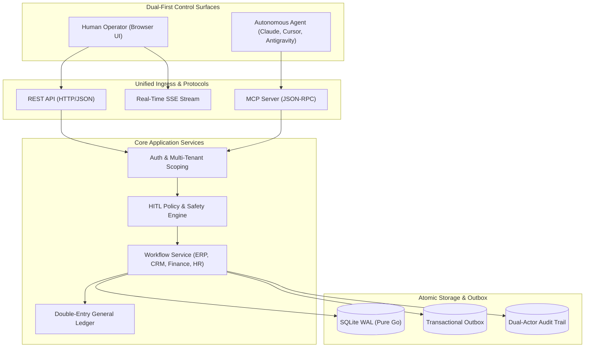
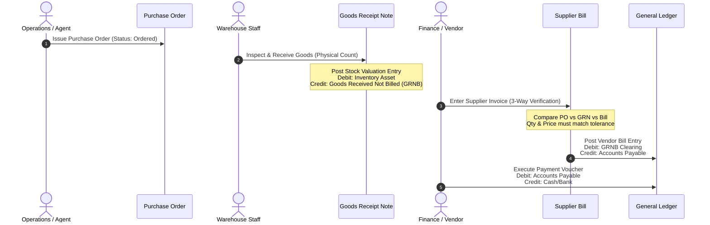

# AO Sphere BOS — Production Master Roadmap & Specification

> **The Dual-First Business Operating System**: Built with equal operational power for **Human Operators** and **Autonomous AI Agents**. A lightweight, single-binary alternative to ERPNext, Odoo Community, and Invoice Ninja.

---

## 1. Executive Vision & Philosophy

AO Sphere is an **Agent-Native Business Operating System (BOS)**. Existing enterprise ERPs (ERPNext, Odoo, SAP) were architected decades ago for manual human data entry, with complex multi-tab forms, heavy page reloads, and afterthought REST APIs. Conversely, modern "AI agent platforms" are frequently mere read-only monitoring dashboards where humans can only review or approve agent actions.

**AO Sphere bridges this divide with a Dual-First Architecture:**
1. **Human Operators** have first-class, direct, interactive control: visual drag-and-drop Kanbans, multi-line item invoice builders, manual stock adjustments, vendor catalogs, customer timeline cards, batch actions, and export capabilities.
2. **AI Agents** interact with the exact same domain services via the Model Context Protocol (MCP), constrained by role-based access control (RBAC), rate limits, financial approval thresholds, and immutable double-entry ledger invariants.
3. **Dual-Actor Audit Ledger**: Every transaction, whether initiated by human click or autonomous agent inference, records explicit cryptographic actor provenance (`HUMAN: user@company.com` vs `AGENT: mcp_procurement_bot`).



---

## 2. Competitive Benchmark & Gap Analysis

| Capability | **AO Sphere (Target)** | **ERPNext** (Frappe) | **Odoo Community** | **Invoice Ninja** | **Dolibarr** |
| :--- | :--- | :--- | :--- | :--- | :--- |
| **Runtime Architecture** | Single compiled Go binary + embedded UI (zero node/python deps) | Heavy Python/Frappe stack + MariaDB + Redis + Node | Python + PostgreSQL + Web framework | PHP / Laravel + MySQL | PHP + MariaDB |
| **Footprint & Cold Boot** | < 30MB RAM, < 1.5s cold boot | > 1.5GB RAM, multi-container | > 800MB RAM, multi-container | > 500MB RAM, multi-container | > 300MB RAM |
| **Agent / MCP Protocol** | **Native first-class MCP server (SSE & Stdio)** | Webhooks & REST only | Third-party modules | Webhooks & REST only | REST API only |
| **Dual-First Interaction** | **Full UI CRUD + Full Agent Automation** | Primarily manual UI | Primarily manual UI | Primarily manual UI | Primarily manual UI |
| **Procurement Cycle** | **3-Way Matching (PO $\rightarrow$ GRN $\rightarrow$ Bill $\rightarrow$ Pay)** | Full 3-Way Match | Full 3-Way Match | Direct PO only | 3-Way Match |
| **Warehouse Structure** | **Multi-Warehouse, Bin Locations, Lot/Serial** | Multi-Warehouse, Batch/Serial | Multi-Warehouse, Batch/Serial | Single Location | Multi-Warehouse |
| **Invoicing & Ledger** | **Integer minor cents double-entry general ledger** | Full ERP double-entry | Full accounting engine | Invoicing only (no full GL) | Double-entry |
| **Document Generation** | **Native PDF (Invoices, POs, Receipts, Quotes)** | Jinja2 HTML-to-PDF | QWeb PDF (wkhtmltopdf) | PhantomJS / Flutter PDF | TCPDF engine |
| **Payment Gateways** | **Stripe, Lemon Squeezy, PayPal webhooks** | Stripe, PayPal, Razorpay | 30+ Gateways | 20+ Gateways | PayPal, Stripe |
| **License Type** | **Apache 2.0 / Dual Commercial** | GNU GPLv3 | GNU LGPLv3 (Core) | Functional Source License / GPL | GNU GPLv3 |

---

## 3. Licensing, Governance & Legal Strategy

### Open-Source vs. Commercial Licensing Model
To enable global developer adoption while supporting commercial SaaS and on-premise enterprise deployments, AO Sphere adopts an enterprise-grade licensing model:

1. **Permissive Core License (Apache 2.0)**:
   - The core monolith, REST API, SQLite storage engine, MCP server, and embedded web UI are licensed under **Apache 2.0**.
   - Allows individuals, startups, and enterprises to self-host, customize, and build commercial products without copyleft contagion (unlike GPL/AGPL).
2. **Dual-License Option for Hosted Enterprise Offerings**:
   - For enterprise features (SAML/SCIM SSO, advanced compliance vaults, white-labeled client portals), a commercial enterprise license provides indemnification, priority SLAs, and proprietary redistribution rights.
3. **Dependency IP Audit**:
   - All Go dependencies are strictly vetted for permissive licenses:
     - `modernc.org/sqlite`: BSD-3-Clause (Pure Go SQLite engine, no CGo)
     - `github.com/google/uuid`: BSD-3-Clause
     - `golang.org/x/crypto`: BSD-3-Clause
     - `github.com/dustin/go-humanize`: MIT
   - **Zero GPL / AGPL dependencies**: Guarantees zero legal friction for enterprise deployment.

---

## 4. Phase-by-Phase Implementation Roadmap

```
Phase 01: Immediate UX Hardening & UI Bug Resolution  ──> Theme Engine, Mobile Breakpoints, Token Injection, A11y
Phase 02: Human-Direct Operational Control (Full CRUD)──> Multi-Line Item Invoice Builder, PO Studio, Kanban Drag & Drop
Phase 03: Core ERP & Multi-Warehouse Supply Chain     ──> 3-Way Matching (GRN), Multi-Warehouse, Lot/Serial Tracking
Phase 04: Advanced Invoicing, Payments & General Ledger──> Native PDF Engine, Stripe/PayPal Webhooks, Credit Notes, FX
Phase 05: Customer 360, Multi-Pipeline CRM & Email    ──> Customer Activity Timeline, Multi-Kanban, SMTP/Email Dispatch
Phase 06: HR, Timesheets & Automated Payroll          ──> Salary Structures, Tax Withholding, Payslip Generator, Leave
Phase 07: Financial Intelligence, Analytics & Exports ──> P&L, Balance Sheet, Cash Flow, CSV/Excel/PDF Export Engine
Phase 08: Agent Platform, Webhooks & MCP Subscriptions──> Webhook Event Engine, Execution Budgets, Agent Handoff
Phase 09: Enterprise Tenancy, 2FA/SSO & Compliance    ──> Multi-Tenant Switching, TOTP 2FA, OAuth2/OIDC, Audit Vault
Phase 10: Packaging, Distribution & Cloud Deployments ──> Docker Distroless, Helm Charts, Cloud-Init, Backup Automation
```

---

### Phase 1 — Immediate UX Hardening & UI Bug Resolution

**Goal:** Resolve all defects discovered during browser testing to provide a polished, responsive, and accessible interface.

#### Checklist (5/5)
- [ ] **Fix Dark Theme System in CSS (`web/css/style.css`)**:
  - Add explicit `.theme-dark` CSS variable overrides for `--bg-primary` (`#0F172A`), `--bg-secondary` (`#1E293B`), `--bg-tertiary` (`#334155`), `--bg-card` (`#1E293B`), `--border-subtle` (`#334155`), and `--text-main` (`#F8FAFC`).
  - Persist theme selection in `localStorage` across page refreshes.
- [ ] **Inject Active Session/Token into MCP Agent Console (`web/js/app.js`)**:
  - Fix the 401 Unauthorized bug in `executeManualToolCall()` by injecting `Authorization: Bearer <token>` or `X-API-Key` headers into `fetch('/mcp/messages')`.
  - Display execution status badges and formatted JSON results in the drawer.
- [ ] **Implement Mobile Responsive Sidebar & Breakpoints**:
  - Add `@media (max-width: 768px)` rules in `style.css` to collapse the 256px sidebar into a hidden slide-out drawer.
  - Add a hamburger menu toggle button in the top navigation bar.
- [ ] **Eliminate Waterfall Cascade (`loadAllData`)**:
  - Replace the global 12-endpoint parallel GET waterfall with targeted cache invalidation (e.g. only refresh `/api/invoices` when an invoice is created).
  - Add an in-memory client-side data store with optimistic UI updates.
- [ ] **Form Accessibility & Explicit `<label for="...">` Association**:
  - Add explicit `id` attributes and matching `<label for="...">` tags to all modal form controls across Deals, POs, SKUs, and Invoices.
  - Eliminate browser a11y console warnings; ensure tab-key keyboard traversal across all interactive modals.

> **Exit Gate:** Dark mode toggles seamlessly, MCP tool executions from the web console succeed with 200 OK, mobile screens display a collapsible navigation drawer, and 0 a11y warnings appear in browser DevTools.

---

### Phase 2 — Human-Direct Operational Control (Full CRUD Interactivity)

**Goal:** Ensure humans have direct, intuitive CRUD manipulation over every business entity—freeing the system from being an agent-only dashboard.

#### Checklist (8/8)
- [ ] **Interactive Multi-Line Item Invoice Builder**:
  - Create a dedicated modal and full-page editor to compose invoices with dynamic line items (SKU picker, quantity, unit price, line discount, tax rate, auto-calculated line totals).
  - Allow instant client selection or on-the-fly customer creation.
- [ ] **Direct Purchase Order Generator with Supplier Catalog**:
  - Visual PO composer allowing operators to pick a supplier, browse supplier SKUs, specify delivery dates, add purchase notes, and save as `draft` or submit for approval.
- [ ] **Interactive SKU & Inventory Management**:
  - Create an "Add SKU" and "Edit SKU" modal for manual catalog creation (code, name, category, cost, selling price, reorder thresholds, initial stock).
  - Add manual stock adjustment dialog with reason codes (`recount`, `damage`, `received`, `shrinkage`).
- [ ] **Quote Composer & Quote-to-Invoice Conversion**:
  - UI interface to draft sales quotes with validity dates, terms, and discounts.
  - "Convert to Invoice" button on accepted quotes and won deals with automatic line item transfer.
- [ ] **Deal & Lead Management Studio**:
  - Drag-and-drop Kanban deal stage movement with stage history tracking.
  - Modal to create, edit, reassign, or archive deals with expected close dates and probability weighting.
- [ ] **Shift Roster & Employee Scheduling Interface**:
  - Interactive calendar/table view to schedule shifts, assign stations, log breaks, and clock employees in/out manually.
  - Add "New Employee" modal with job title, department, wage type (hourly/salary), and hourly rate.
- [ ] **Task Board & Assignment Matrix**:
  - Interactive task board with priority badges (`low`, `medium`, `high`, `urgent`), due date pickers, assignee selection, and checklist subtasks.
- [ ] **Batch Actions & Data Table Filters**:
  - Multi-select checkboxes on invoices, inventory, and deals for batch actions (batch export, batch mark as sent, batch status update).
  - Instant text filter and column sorting across all list views.

> **Exit Gate:** A human operator can run an entire business day—onboard a customer, create a deal, build a 5-line invoice, order parts from a supplier, and clock in staff—entirely from the UI without running a single AI prompt.

---

### Phase 3 — Core ERP & Multi-Warehouse Supply Chain

**Goal:** Match the supply chain sophistication of ERPNext and Odoo with 3-way matching, multi-site routing, and lot tracking.

#### 3-Way Matching Workflow



#### Checklist (8/8)
- [ ] **Goods Receipt Notes (GRN / Delivery Receipts)**:
  - Separate physical stock receipt from financial billing.
  - Support partial receipts (e.g. 30 of 50 received, remaining 20 on backorder) with automatic backorder PO generation.
- [ ] **3-Way Matching Policy Engine**:
  - Automated comparison between PO items, GRN received quantities, and Supplier Bill invoice totals.
  - Flag quantity variances or price discrepancies exceeding configurable threshold (e.g. > 2%) for human manager review.
- [ ] **Multi-Warehouse & Storage Bin Architecture**:
  - Schema support for multiple physical locations (`warehouses` table: `id`, `org_id`, `name`, `code`, `address`).
  - Storage bins/locations within warehouses (aisle, rack, shelf, bin).
  - Inter-warehouse stock transfer orders with transit tracking (`transfer_orders` table).
- [ ] **Batch / Lot & Serial Number Tracking**:
  - Track individual serial numbers for electronics/high-value hardware.
  - Track batch/lot numbers with manufacturing and expiration dates for perishable/regulated supplies.
- [ ] **Landed Cost Distribution**:
  - Allocate shipping, customs duties, freight, and insurance costs across received items to calculate true inventory unit cost.
- [ ] **Autonomous Reorder Policies**:
  - Configurable replenishment rules: trigger draft POs automatically when `stock_quantity + reserved_quantity <= min_threshold`.
  - Lead-time buffer calculations based on supplier historical reliability ratings.
- [ ] **Physical Inventory Count & Reconciliation**:
  - Stocktaking workflows: freeze inventory, record physical counts, compute variances, and post adjusting journal entries.
- [ ] **Supplier Management & Performance Scorecards**:
  - Vendor directory with payment terms (`Net 15`, `Net 30`, `Due on Receipt`), lead times, historical fulfillment accuracy, and quality ratings.

> **Exit Gate:** Warehouse staff can receive partial goods with a GRN, finance verifies supplier bills with automated 3-way matching, and inventory tracks quantities across multiple physical warehouses.

---

### Phase 4 — Advanced Invoicing, Payment Gateways & General Ledger

**Goal:** Deliver enterprise-grade financial capabilities with pixel-perfect PDFs, gateway webhooks, and comprehensive accounting.

#### Checklist (8/8)
- [ ] **Native Server-Side PDF Document Generator**:
  - High-performance, pixel-perfect PDF rendering for Invoices, Purchase Orders, Quotes, and Receipts.
  - Customizable company branding, logo embedding, tax registration numbers, and banking details.
  - REST endpoints: `GET /api/invoices/:id/pdf` and `GET /api/purchase-orders/:id/pdf`.
- [ ] **Payment Gateway Integration (Stripe & Lemon Squeezy)**:
  - Generate secure Stripe Checkout / Payment Link sessions from invoice records.
  - Secure webhook endpoint (`/api/webhooks/stripe`) with cryptographic signature verification.
  - Webhook automations: On `checkout.session.completed`, automatically mark invoice as `paid` and post balanced double-entry ledger entry.
- [ ] **Credit Notes, Refunds & Reversals**:
  - Issue full or partial credit notes against issued or paid invoices.
  - Post proper ledger reversals: Debit Revenue / Sales Tax Payable, Credit Accounts Receivable / Cash.
- [ ] **Multi-Currency General Ledger**:
  - Record transactions in foreign currencies (EUR, GBP, JPY, CAD) with historical exchange rates table (`exchange_rates`).
  - Auto-calculate realized and unrealized FX gains/losses upon payment settlement.
- [ ] **Configurable Multi-Jurisdiction Tax Engine**:
  - Support US Sales Tax (state/county rules), EU VAT (reverse charge handling), and GST/HST.
  - Effective-dated tax rates applied automatically based on customer delivery address.
- [ ] **Complete Chart of Accounts & Sub-Ledgers**:
  - Pre-packaged standard Chart of Accounts (Assets, Liabilities, Equity, Revenue, Cost of Goods Sold, Operating Expenses).
  - Support custom account creation with parent-child account hierarchies.
- [ ] **Bank Reconciliation & Statement Import**:
  - Support statement upload in standard formats (OFX, QIF, CSV).
  - Automated rule-based matching between bank transactions and open ledger entries.
- [ ] **Fiscal Periods & Year-End Close Automation**:
  - Lock accounting periods to prevent backdated edits to closed quarters.
  - Year-end closing journal entry: zero out Revenue and Expense accounts into Retained Earnings.

> **Exit Gate:** Customers can pay invoices via Stripe Checkout links, webhooks automatically post balanced double-entry journal entries, and downloadable branded PDFs are generated on demand.

---

### Phase 5 — Customer 360, Multi-Pipeline CRM & Communication

**Goal:** Transform the basic sales pipeline into an omni-channel customer intelligence and communication hub.

#### Checklist (8/8)
- [ ] **Customer 360 Activity Timeline**:
  - Comprehensive customer record view aggregating: contact details, linked deals, open quotes, invoice history, payment status, support tasks, and audit logs.
- [ ] **Multiple Configurable Sales Pipelines**:
  - Support distinct pipelines for different business units (e.g. *Direct Hardware Sales*, *SaaS Subscriptions*, *Consulting Services*).
  - Configurable stage names, probability percentages, and mandatory stage requirements.
- [ ] **Automated Deal Decay Alerts**:
  - Highlight deals that have remained stagnant in a stage past their expected threshold (e.g. > 14 days in *Proposal Sent*).
  - Autonomous agent prompt triggers: generate follow-up email drafts for dormant leads.
- [ ] **Transactional Email Dispatch Engine**:
  - Built-in SMTP, Resend, or SendGrid integration to dispatch quotes, invoices, and payment receipts directly to customer contacts.
  - HTML email templates with embedded PDF attachments and click-to-pay buttons.
- [ ] **Inbound Lead Capture Webhooks & Forms**:
  - Public endpoint (`/api/v1/leads/capture`) with API key and reCAPTCHA support for website contact forms.
  - Auto-enrich lead metadata and route to designated sales reps or AI qualification agents.
- [ ] **Communication Notes & Logged Activities**:
  - Log phone calls, meeting summaries, email threads, and internal team mentions (`@username`) on deal records.
- [ ] **Client Self-Service Payment Portal**:
  - Tokenized, secure public URL for clients (`/portal/invoice/:token`) to view their invoice, download PDFs, view payment history, and pay via credit card.
- [ ] **Customer Reputation & Review Aggregation**:
  - Ingest customer feedback from Google Business, Trustpilot, or custom satisfaction surveys.
  - AI-assisted review triage and sentiment categorization with human approval for public draft replies.

> **Exit Gate:** Sales reps manage multiple pipelines with visual deal decay warnings, invoices are emailed with PDF attachments directly to clients, and clients can view/pay invoices on a secure self-service portal.

---

### Phase 6 — Human Resources, Shift Scheduling & Automated Payroll

**Goal:** Deliver complete workforce management, timesheet auditing, and salary disbursement without third-party HR tools.

#### Checklist (7/7)
- [ ] **Employee Profile & Employment Lifecycle**:
  - Schema for employee records: personal details, emergency contacts, hire dates, job titles, department, reporting manager, tax ID, and banking details for direct deposit.
- [ ] **Visual Shift Roster & Drag-and-Drop Scheduling**:
  - Weekly and monthly visual calendar to assign shifts across departments and stations.
  - Shift conflict detection (double-booking, overtime threshold violations, insufficient rest periods).
- [ ] **Time & Attendance Tracking (Web Timeclock)**:
  - Employee digital clock-in/clock-out interface with break tracking and IP/geo-fencing validation.
  - Automated timesheet generation from clock events with manager review and approval workflows.
- [ ] **Salary Structures & Payroll Computation**:
  - Support hourly wages, fixed monthly salaries, overtime multipliers (1.5x, 2.0x), and recurring allowances/deductions.
  - Automated payroll calculation: Gross Pay, Tax Withholding, Social Contributions, Benefits Deductions, and Net Pay.
- [ ] **Automated Monthly Payslip Generation**:
  - Generate downloadable PDF payslips for employees detailing earnings and deductions.
  - Post integrated double-entry payroll entry: Debit Payroll Expense / Tax Expense, Credit Payroll Payable / Taxes Withheld.
- [ ] **Leave & Paid Time Off (PTO) Management**:
  - PTO policy configuration: Vacation, Sick Leave, Parental Leave with accrual balances.
  - Employee leave request form with manager approval routing and calendar sync.
- [ ] **HR Document Vault & Compliance**:
  - Secure storage for employment contracts, NDAs, identification documents, and performance evaluations with role-gated access (`manage_hr` permission required).

> **Exit Gate:** Employees log shifts through the web timeclock, managers approve timesheets, and the system computes payroll, outputs PDF payslips, and posts balanced payroll ledger entries.

---

### Phase 7 — Financial Intelligence, Analytics & Document Exports

**Goal:** Provide executive-level financial reporting and business intelligence without external BI tools.

#### Financial Reports Matrix

| Report | Purpose | Format / Metrics |
| :--- | :--- | :--- |
| **Profit & Loss (P&L)** | Operational performance over time period | Revenue $-$ COGS $=$ Gross Profit $-$ OPEX $=$ Net Profit |
| **Balance Sheet** | Point-in-time financial position | Assets $=$ Liabilities $+$ Equity ($\sum \text{Debits} == \sum \text{Credits}$) |
| **Cash Flow Statement** | Cash liquidity tracking | Operating Cashflow, Investing Cashflow, Financing Cashflow |
| **Trial Balance** | Real-time general ledger debit/credit verification | Unadjusted and Adjusted Trial Balance per account |
| **Aged Receivables (A/R)** | Overdue invoice aging breakdown | Current, 1–30 Days, 31–60 Days, 61–90 Days, 90+ Days |
| **Inventory Valuation** | True value of on-hand inventory | FIFO / Weighted Average Cost $\times$ Available Stock |

#### Checklist (6/6)
- [ ] **Dynamic Financial Statement Generator**:
  - Standardized financial reporting engine calculating real-time P&L, Balance Sheet, and Cash Flow over arbitrary date ranges (`/api/reports/pnl`, `/api/reports/balance-sheet`).
- [ ] **Aged Accounts Receivable & Payable (A/R & A/P) Reports**:
  - Visual aging buckets with drill-down links to delinquent customer invoices and upcoming supplier payment deadlines.
- [ ] **Inventory Turnover & Stock Valuation Reports**:
  - Calculate stock turnover ratios, days sales of inventory (DSI), and dead-stock alerts for SKUs with zero movement in > 90 days.
- [ ] **Sales Velocity & Pipeline Analytics**:
  - Win/loss ratios, average deal size, sales cycle duration, and rep conversion metrics.
- [ ] **Universal CSV, Excel & PDF Export Engine**:
  - Streamlined data export across all tables with column selection, date filtering, and clean spreadsheet formatting.
- [ ] **Executive Dashboard & KPI Cards**:
  - Real-time widgets on dashboard: Monthly Recurring Revenue (MRR), Gross Margin %, Cash Runway, Open Purchase Commitments, and Pending Approvals.

> **Exit Gate:** Executives can generate standard P&L and Balance Sheet reports verified against double-entry ledger entries, export clean spreadsheets, and track real-time aging receivables.

---

### Phase 8 — Autonomous MCP Agent Platform & Webhooks

**Goal:** Turn MCP from a request/response toolset into a comprehensive autonomous agent orchestration platform.

#### Checklist (7/7)
- [ ] **Outbox-Driven Webhook Subscriptions for External Agents**:
  - Allow external AI agents (Claude Desktop, custom agent daemons) to register webhook URLs to receive real-time business events (`po.created`, `invoice.overdue`, `deal.won`, `stock.low`).
  - Webhooks include HMAC-SHA256 signature verification and automatic retry with exponential backoff.
- [ ] **Per-Agent Execution Budgets & Rate Quotas**:
  - Granular limits per API key: max tool calls per minute, max execution cost/tokens, and concurrent execution slot caps.
  - Reject runaway agent tool loops with clear error code `-32029 (Rate Limit Exceeded)`.
- [ ] **Human-Agent Handoff & Escalation Workflows**:
  - When an agent encounters ambiguous inputs or negative sentiment reviews, automatically generate an approval/review ticket for human intervention.
  - Seamless handoff comments and execution trace context visible in the UI Approval Drawer.
- [ ] **Agent Execution Replay & Step Debugger**:
  - Web UI viewer to inspect historical agent runs (`agent_executions` table): tool name, input arguments, execution duration, database mutations, and return payloads.
- [ ] **Context Injection & Semantic Memory Scoping**:
  - Automatically provide agents with pertinent context prompts (company profile, active currency, standard tax rate, supplier lead times) without polluting tool parameters.
- [ ] **Dynamic MCP Tool Registry & Schema Introspection**:
  - Programmatic introspection endpoint exposing tool definitions, JSON schemas, safety categories, and required RBAC permissions.
- [ ] **Prompt Injection Defense & Input Sanitization**:
  - Continuous validation on external strings (customer reviews, email replies, web listings) to neutralize prompt injection and jailbreak payloads before reaching agents.

> **Exit Gate:** External agents receive signed webhooks for business events, operate within strict rate and token budgets, and hand off edge cases to human operators with full audit context.

---

### Phase 9 — Enterprise Multi-Tenancy, Auth & Compliance

**Goal:** Provide rock-solid enterprise multi-tenancy, authentication protocols, and regulatory compliance.

#### Checklist (8/8)
- [ ] **Multi-Company / Multi-Tenant Switching UI**:
  - Top navigation tenant switcher allowing users with multi-org permissions to switch active business entities with zero data leakage.
  - Strict tenant scoping on every SQL query (`WHERE org_id = ?`) and mutation verification.
- [ ] **Self-Service User Invitation & Password Reset**:
  - Tokenized email invite links for new employees with role pre-assignment.
  - Secure cryptographic password reset flow with 15-minute token expiry.
- [ ] **Two-Factor Authentication (2FA / TOTP)**:
  - Standard RFC 6238 TOTP support (Google Authenticator, 1Password) with QR code setup and emergency recovery codes.
- [ ] **OAuth2 / OIDC & SAML Single Sign-On (SSO)**:
  - Support enterprise identity providers (Google Workspace, Microsoft Entra ID / Azure AD, Okta) for corporate login.
- [ ] **Granular Custom Role Builder**:
  - Beyond standard roles (Admin, Finance, HR), allow administrators to compose custom permission sets tailored to specific organizational workflows.
- [ ] **Immutable Security Audit Vault**:
  - Write-only audit log storage with SHA-256 chain hashing to detect any unauthorized database tampering.
- [ ] **GDPR & Privacy Compliance Suite**:
  - Automated "Export My Data" package generation and "Right to be Forgotten" account anonymization routines.
- [ ] **SOC2 Type II Readiness Controls**:
  - Automated session invalidation after inactivity (30 minutes), password complexity enforcement, and quarterly access review reports.

> **Exit Gate:** Multi-company operators can switch organizations with a single click, 2FA/SSO protects all logins, and immutable audit logs guarantee tamper-evident compliance.

---

### Phase 10 — Packaging, Distribution & Cloud Deployments

**Goal:** Make deployment as simple as a single command while providing rock-solid disaster recovery and automated updates.

#### Checklist (8/8)
- [ ] **Minimal Distroless / Scratch Docker Container**:
  - Multi-stage Dockerfile producing a tiny (< 25MB), zero-dependency, non-root Linux container.
- [ ] **Docker Compose Production Bundle**:
  - Ready-to-deploy `docker-compose.yml` incorporating Caddy (automatic Let's Encrypt TLS reverse proxy), AO Sphere monolith, and automated backup sidecar.
- [ ] **One-Click Cloud Deployments**:
  - Deployment templates for Railway, Fly.io, Render, and Hetzner cloud-init scripts.
- [ ] **Kubernetes Helm Chart**:
  - Production Helm chart with StatefulSet/PersistentVolumeClaim for SQLite WAL storage, HorizontalPodAutoscaler, and Ingress routing.
- [ ] **Automated Encrypted Cloud Backups**:
  - Native S3/R2 backup integration: scheduled daily encrypted database snapshots uploaded directly to customer cloud storage.
- [ ] **Zero-Downtime Rolling Update & Migration Strategy**:
  - Automated schema migration on container boot inside an idempotent serialized transaction.
- [ ] **Health Monitoring & Auto-Restart Runbooks**:
  - Integrated Prometheus `/metrics` and health endpoints (`/healthz`, `/readyz`) hooked into container restart policies.
- [ ] **Native CLI Binary Distribution**:
  - GitHub Releases publishing cross-compiled static binaries for Linux (amd64, arm64), macOS (Apple Silicon, Intel), and Windows.

> **Exit Gate:** A business can deploy AO Sphere to a production server with automatic HTTPS in under 3 minutes using `docker compose up -d` or run a standalone native binary.

---

## 5. Implementation Roadmap Matrix

```
┌──────────────────────────────────────────────────────────────────────────────────┐
│                             AO SPHERE MASTER ROADMAP                             │
├─────────┬───────────────────────────────────────┬────────────┬───────────────────┤
│ Phase   │ Focus Domain                          │ Priority   │ Target Outcome    │
├─────────┼───────────────────────────────────────┼────────────┼───────────────────┤
│ Phase 01│ Immediate UX & Bug Hardening          │ Urgent     │ Zero browser bugs │
│ Phase 02│ Human-Direct Operations (Full CRUD)   │ High       │ Dual-first parity │
│ Phase 03│ 3-Way Matching & Multi-Warehouse ERP  │ Critical   │ Enterprise supply │
│ Phase 04│ Invoicing, PDF, Stripe & General GL   │ Critical   │ Complete finance  │
│ Phase 05│ Customer 360, CRM & Communications   │ High       │ Omni-channel sales│
│ Phase 06│ HR Roster, Timesheets & Payroll       │ Medium     │ Unified workforce │
│ Phase 07│ Financial Statements & Analytics      │ High       │ Executive insights│
│ Phase 08│ Autonomous Agent Platform & Webhooks  │ Critical   │ True AI autonomy  │
│ Phase 09│ Multi-Tenancy, 2FA/SSO & Compliance   │ High       │ Enterprise-ready  │
│ Phase 10│ Packaging, Docker & Cloud Deployments │ High       │ 1-click launch    │
└─────────┴───────────────────────────────────────┴────────────┴───────────────────┘
```

---

## 6. Next Immediate Steps (Sprint Execution)

To immediately resolve the gaps identified during browser testing, development should proceed in the following sprint order:

1. **Sprint 1 (Phase 1 Fixes)**:
   - Add `.theme-dark` CSS variable overrides in `web/css/style.css` so Dark Mode actually transforms the UI.
   - Inject session token in `web/js/app.js` `executeManualToolCall()` to eliminate the 401 Unauthorized agent drawer error.
   - Add responsive `@media` drawer to collapse sidebar on screens $< 768px$.
   - Replace `loadAllData()` waterfall with granular entity reload.
   - Add `<label for="...">` associations to all modal forms.
2. **Sprint 2 (Phase 2 Full CRUD)**:
   - Implement the interactive multi-line item invoice builder and quote-to-invoice UI button.
   - Add SKU creation modal and direct PO generation form.
3. **Sprint 3 (Phase 3 & 4 Core Invariants)**:
   - Implement Goods Receipt Notes (GRN) and 3-way matching in `service` and `store`.
   - Implement native PDF rendering for Invoices and Purchase Orders.
