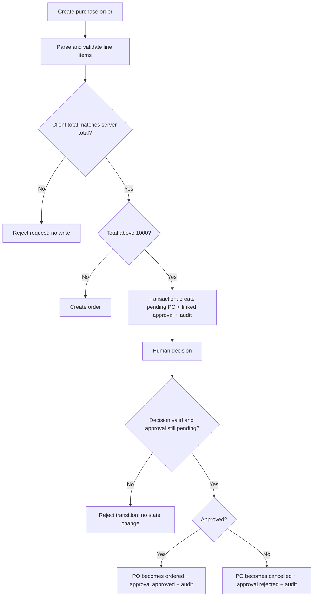

# AOSphere — Business Operating System (BOS)
## System overview and engineering review

**Review basis:** public repository source on `main`, inspected on 20 October 2026. This is a static code review of the visible source. It is not a claim that the full test suite has run; no local runtime/database was available through this review.

## 1. Executive summary

AOSphere is an agent-native business operating system prototype that brings multiple operating domains into a single UI and data store. The implementation combines a Go HTTP server, SQLite persistence, a browser-based dashboard, REST endpoints, Server-Sent Events (SSE), and a Model Context Protocol (MCP) server that exposes selected business operations to AI agents.

The key product idea is strong: agents can inspect business data and perform bounded actions, while high-value actions should be brought to a human approval inbox and all actions should have an auditable actor/provenance record.

The largest risk is that the current code presents governance as a UI/workflow concept but does not enforce every advertised guarantee in the domain layer. Approval decisions only update approval status; the Go endpoints have no visible authentication/authorization middleware; purchase order creation trusts a client-supplied total; key validations and audit failures are ignored; and the repository maintains a second Python server with overlapping but non-identical behaviour. Treat this version as a promising internal prototype, not yet as a safe unattended business execution system.

## 2. What is in the codebase

### Runtime and components

- **Go entry point — `main.go`:** parses port/database/MCP-stdio flags, initializes SQLite, constructs the store and MCP server, registers API routes, embeds the static web assets, and shuts down on OS signals.
- **SQLite schema and seed data — `internal/db/schema.go`:** defines tables and sample records. SQLite WAL, a busy timeout, foreign-key mode, and a bounded connection pool are configured.
- **Domain models — `internal/db/models.go`:** JSON-facing types for SKU, supplier, purchase order, customer, deal, invoice, expense, employee, shift, task, local listing, review, approval, audit log, and financial summary.
- **Business/data-access layer — `internal/store/store.go`:** implements SQL-backed inventory, procurement, CRM, invoicing/summary, workplace, listing/reputation, approval, and audit operations.
- **REST/SSE API — `internal/api/api.go`:** exposes module endpoints and broadcasts domain events to connected browsers.
- **MCP adapter — `internal/mcp/server.go`:** exposes tool/resource/prompt definitions over JSON-RPC, with HTTP SSE/message and stdio modes.
- **Browser interface — `web/index.html`, `web/css/style.css`, `web/js/app.js`:** a single-page dashboard with module navigation, modal actions, a command palette, a live event feed, approval inbox, audit feed, and manual MCP tool tester.
- **Alternative Python runtime — `aosphere_server.py`:** another HTTP/SSE/MCP-style server using SQLite directly. It has overlapping endpoints and separate implementation logic.

## 3. Product capabilities visible in source

### ERP and supply chain
- List SKUs, show threshold breaches, and adjust stock.
- Trigger a reorder workflow when stock reaches or falls below the minimum threshold.
- Create/list purchase orders and list suppliers.
- Intended rule: purchases above $1,000 route to human approval.

### CRM and sales
- List customers and deals, create deals, and move a deal between stages.
- Exposed stages include lead, qualified, proposal, negotiation, won, and lost.

### Finance
- Create and list invoices, list expenses, and return a high-level financial summary.
- Summary reports paid invoice totals as revenue, unpaid invoice totals as receivables, expenses, and revenue less expenses as net profit.

### HR and productivity
- List employees and shifts, change shift status, list tasks, and update task status.

### Business presence and reputation
- Store a master name/address/phone/website (NAP) and mark directory records as synced.
- List review records and draft or publish a response status.

### Agent integration and governance
- MCP tools cover stock inspection/adjustment, purchase order creation, deal-stage changes, financial summary, invoice creation, NAP update, draft review reply, and pending approvals.
- MCP resources cover inventory, CRM pipeline, financial summary, and review feed.
- The UI offers an approval inbox and an audit trail of recorded actors/actions.

**Important boundary:** the code’s NAP sync updates local database rows; no external directory API integration is visible. Similarly, invoice generation stores invoice data; it does not by itself establish tax/legal compliance, send a real invoice, or collect money. A review row changing to “published” does not prove a third-party review site was contacted. Such capabilities should be labelled as local state/drafts until real integrations and delivery receipts exist.

## 4. High-priority findings

### P0 — governance and access control

1. **Approval decision is not linked to execution.** `Store.DecideApproval` changes the approval record status and logs a decision, but does not resolve the action payload into an approved purchase order execution or rejection/cancellation workflow. The UI can display “approved” although the protected business action has not occurred.
2. **Approval state is not protected as a state machine.** Decisions are not visibly restricted to exactly `approved` or `rejected`, and the update query can overwrite an already-decided approval. Use a conditional transition from pending, check affected row count, and make repeated decisions idempotent or reject them.
3. **No visible authentication/authorization on mutating routes.** The API hardcodes actors such as `human/web_user` and `admin`; those strings are not proof of identity. MCP HTTP endpoints can call business-changing tools. Before exposing this server outside a trusted local environment, put authentication, role/permission checks, and per-tool authorization in front of mutations.
4. **Purchase-order approval threshold can be bypassed.** The REST handler identifies the web caller as human, while `CreatePurchaseOrder` routes only agent-originated high-value POs to pending approval. The UI says POs above $1,000 go through approval, but this is not enforced for human REST requests. Enforce policy centrally for all actors and channels, with explicit roles for any emergency override.

### P1 — business data integrity

5. **Client-supplied PO totals are trusted.** The POST endpoint accepts `total` separately from `items_json`, so a caller can submit items worth more than the reported amount and avoid a value threshold. Parse and validate line items on the server and derive totals there.
6. **Invoice inputs lack strong domain validation.** The store derives total as subtotal + tax, but it does not validate positive/non-negative quantities and prices, customer existence, date format, currency, tax rules, or item JSON consistency. The web client hardcodes an 8% tax assumption. Tax must be configured for the relevant jurisdiction rather than embedded in a generic BOS client.
7. **Money uses floating-point values.** Financial amounts are represented as `float64`/SQLite `REAL`. This risks rounding discrepancies. Use integer minor units or a decimal library, define currency on every transaction, and avoid assuming one currency or tax rate globally.
8. **Inventory reorder duplication and reservation semantics.** Every stock adjustment that ends at or below threshold can generate another reorder. There is no visible de-duplication against an open/pending PO. `reserved_quantity` is exposed, but available stock is not centrally computed as on-hand minus reserved, nor is a reservation workflow present.
9. **Database errors are silently ignored in important paths.** Examples include SQL inserts in the auto-reorder transaction and audit writes, and the financial summary ignores query errors. A failed approval/PO/audit insert must fail the transaction and return an error rather than report success.
10. **State/status values are not consistently constrained.** Deal, task, shift, approval, invoice, and purchase order status changes need explicit allowed values and legal transition rules; otherwise invalid state strings can be persisted.
11. **Record identifiers use second-resolution business numbers.** POs and invoices use `PO-<Unix seconds>` and `INV-<Unix seconds>`. Concurrent creates can collide due to unique constraints. Allocate numbers via a transactional sequence or a unique, auditable number service.

### P1 — application security and reliability

12. **Unsafe HTML interpolation in the client.** API/database content is inserted into `innerHTML` across deal, review, approval, audit, and other views. Untrusted strings (such as a review, customer name, task title, or approval metadata) could inject markup/script. Escape all interpolated text, build DOM nodes safely, or use a trusted templating strategy. Do not rely on SQLite content being trusted.
13. **CORS policy is permissive.** API/SSE/MCP handlers set `Access-Control-Allow-Origin: *`. For endpoints that mutate business state, use same-origin by default or an explicit allowlist; pair with authentication and CSRF protections where browser cookies are used.
14. **HTTP server binding is public by default on all interfaces.** `:8080` binds all interfaces. Until auth/TLS/reverse-proxy protections are configured, default to loopback for local development and require an explicit opt-in to listen externally.
15. **Request size and decoder limits are missing.** Add bounded request bodies, strict JSON decoding (reject unknown fields where suitable), and timeouts/rate limits. The Python server also reads the declared body length directly and runs on the basic single-process `HTTPServer`.
16. **MCP SSE session/channel concurrency needs hardening.** The Go handler sends to a session channel after releasing the read lock, while the SSE handler closes the channel during session cleanup. A concurrent POST and disconnect can cause a send-on-closed-channel panic. Use a per-session lifecycle/locking design and non-blocking bounded enqueue.
17. **MCP errors can look like successful tool results.** Tool failures are often returned as text inside a JSON-RPC result rather than a structured tool error. Agents may treat “Error updating…” as a normal success-shaped payload. Return a consistent structured error and/or `isError: true` tool result.
18. **SSE events are best-effort, not a durable event stream.** Channels are bounded and broadcasts drop events when full. That can be fine for refresh hints, but the system must not treat SSE as the source of truth; add event IDs/replay if clients need reliable delivery.

## 5. Architecture issue: Go and Python implementations

The Go and Python servers both implement significant portions of the same application, API routes, SQLite operations, audit logic, SSE, and MCP handling. Their logic is already not equivalent. For example, the Go store conditionally routes agent-created POs over $1,000 to pending approval; the Python PO handler marks the human-created order as ordered. Approval handling and actor records also differ. The two runtimes can therefore produce different business outcomes from the same UI action.

**Recommendation:** declare Go as the canonical runtime (it has the structured packages and embedded UI) and either remove the Python implementation or make it a thin, tested adapter to shared API contracts. If Python is retained solely for Windows compatibility, add parity tests that run the same request scenarios against both implementations and prove equivalent database results. Do not permit both servers to independently mutate the same production database until consistency is demonstrated.

## 6. Business scenario walkthroughs

### Scenario A — Low stock creates a reorder request
1. Inventory starts at 6 units with a minimum threshold of 15; reorder quantity is 50 and unit cost is $45.
2. An agent consumes 1 unit. The stock update becomes 5 and the reorder rule runs.
3. Expected policy result: one open reorder request is created, with 50 × $45 = $2,250, and is held as pending human approval.
4. Current risk: repeated edits while stock remains low may create multiple POs/approvals; SQL insertion errors in the transaction are ignored; duplicate open POs are not visibly checked.

### Scenario B — A human reviews a $2,250 PO
1. The approval inbox displays an approval payload.
2. Human selects Authorize or Decline.
3. Expected result: identity and permission are checked; decision is allowed only while pending; approve triggers a validated, idempotent action execution; reject safely terminates the proposal; all steps are transactionally linked and audited.
4. Current result visible in code: the approval row is updated and an audit record is attempted, but the PO/action itself is not advanced by the approval decision handler. A hardcoded actor label is used instead of authenticated identity.

### Scenario C — Manual PO with manipulated total
1. A caller sends a line item worth $5,000 but sets `total: 10`.
2. The current route passes the submitted total to the store without reconciling it against `items_json`.
3. Policy based on the reported value can be bypassed. Server-side item parsing and total derivation must be mandatory.

### Scenario D — Concurrent invoice creation
1. Two invoice requests arrive in the same second.
2. Both may attempt the same `INV-<Unix seconds>` number.
3. The unique constraint may reject one request. Clients currently often show a success toast without checking `response.ok`.
4. Use a transactional sequence and return clear success/failure states from the UI.

### Scenario E — Malicious review text
1. A review includes markup such as an image tag with an event handler.
2. The review is returned by the API and interpolated into `innerHTML`.
3. The browser can interpret it as markup rather than text. Treat all API-provided strings as untrusted and escape them before rendering.

### Scenario F — MCP request overlaps disconnect
1. An agent sends a POST to a live SSE session while the SSE client disconnects.
2. Session cleanup deletes and closes the channel, while the POST path may still hold the channel reference.
3. A concurrent send can panic the process. Session enqueue/close must be coordinated under one lifecycle lock or via a session object that never exposes a closable channel to senders.

### Scenario G — Marking a review reply “published”
1. The UI calls `/api/reviews/reply` with `publish: true`.
2. The database stores reply text and marks its status `published`.
3. No external platform adapter or delivery receipt is visible in the code path. The UI should say “marked published locally” until a real provider API confirms publication.

## 7. Recommended target design

Keep a simple monolith for now; the current product does not need premature microservices. Introduce stricter boundaries inside the Go app:

```text
Browser UI / approved MCP client
             |
   Authentication + policy middleware
             |
     REST API / MCP transport
             |
   Application services / use cases
    |         |           |
  ERP/CRM  Finance/HR  Governance
             |
   Transactional domain store
             |
 SQLite (early stage) / Postgres (multi-user scale)
             |
 Outbox + audit/event log + external provider adapters
```

Key design rules:
- Route REST and MCP mutations through the same application service functions.
- A single authorization/policy layer decides who may perform each action, including thresholds.
- Human approval is a durable command workflow: `pending → approved/rejected → executing → completed/failed`, with idempotency keys and a record of the payload/version approved.
- Only the server calculates amounts from validated line items.
- Financial postings should eventually use an explicit ledger rather than deriving all accounting state from invoice and expense totals.
- A domain transaction writes both the business change and audit/outbox record; external integrations run asynchronously from an outbox with retries and provider receipts.
- Keep local draft state distinct from external side effects (e.g., draft reply vs provider-published reply).
- Use explicit currency, tax profile, time zone, date rules, and business entity/tenant scope.

## 8. Prioritised implementation plan

### Sprint 0 — prevent unsafe actions
1. Add authentication middleware and role-based authorization before exposing routes or MCP over a network.
2. Enforce one central approval policy for high-impact actions regardless of whether the caller is an agent or a human.
3. Fix approval state transitions and link each approval to the exact protected action; implement idempotent execution/rejection.
4. Validate and calculate PO/invoice line items on the server, reject invalid prices/quantities/dates, and use one currency/tax policy source.
5. Disable or remove the duplicate Python runtime until parity is tested.
6. Add safe HTML rendering to the UI.

### Sprint 1 — integrity and tests
7. Propagate every SQL/audit error; make multi-record workflows transactional.
8. Prevent duplicate auto-reorders when a matching open/pending PO exists.
9. Replace second-based business numbers with a transactional allocator.
10. Add domain enums/check constraints and transition guards.
11. Harden MCP session lifetime, input schemas, payload limits, and structured errors.
12. Fix UI actions to check HTTP status, display server error details, and avoid optimistic “success” toasts on failures.

### Sprint 2 — production operating controls
13. Add tenant/business entity scoping, least-privilege roles, secret management, TLS/reverse-proxy guidance, rate limits, request IDs, and structured logs.
14. Add external provider adapters with explicit capability states and delivery receipts for NAP/reviews/invoices.
15. Add migrations/versioning, backups/restore drills, health/readiness endpoints, metrics, and deployment documentation.
16. Add ledger-grade accounting, reconciliation, tax profiles, audit retention, and exportable reports before using it for statutory financial records.

## 9. Regression test matrix

| ID | Input/scenario | Expected result |
|---|---|---|
| INV-01 | Stock decrement below zero | Reject; no stock update; audit should record a rejected attempt if policy requires it |
| INV-02 | Same SKU is already below threshold with an open pending PO | Do not create another active reorder; return the existing request or explain the deduplication |
| INV-03 | Simultaneous stock adjustments | No lost update; stock and reorder decision match the committed final quantity |
| GOV-01 | Agent creates PO for $1,001 | Pending approval; not ordered/executable yet |
| GOV-02 | Human creates PO for $1,001 without override permission | Pending approval or forbidden according to policy; never silently bypass threshold |
| GOV-03 | Approve a pending PO | One validated action executes once; approval and PO states reconcile in one transaction |
| GOV-04 | Reject a pending PO | Protected action is not executed; linked PO/request becomes rejected/cancelled |
| GOV-05 | Re-approve an already decided approval | Conflict/idempotent response; no duplicate side effect |
| FIN-01 | Quantity/price negative, NaN, infinity, or malformed item JSON | Reject with validation error and no write |
| FIN-02 | Two invoice creates concurrently | Both receive unique invoice numbers or one clear retryable error; no ambiguous UI success |
| FIN-03 | Tax profile changes | Invoice uses explicit effective-dated tax/currency rules, not a hardcoded 8% UI value |
| SEC-01 | Unauthenticated POST to mutating route | 401/403 and no database write |
| SEC-02 | Low-privilege user attempts approval | 403 and no approval decision |
| SEC-03 | Review content contains HTML/JS payload | Rendered as text; no script execution |
| MCP-01 | Invalid JSON-RPC parameters | Structured JSON-RPC error, no state change |
| MCP-02 | MCP caller attempts a protected action without approval | Tool returns explicit policy/approval-required state; no execution |
| MCP-03 | Session closes concurrently with POST | No panic; request gets a safe session-closed response |
| UI-01 | API returns 400/500 | No success toast; useful error surfaced; form remains recoverable |
| PAR-01 | Same mutation through Go and Python server | Identical policy result and database state, if Python is retained |

## 10. What this review did and did not verify

Verified by reading source:
- Repository layout and primary runtime entry points.
- Domain model/schema coverage and major route/tool names.
- Specific code paths described in the findings above.

Not verified in this review:
- Compilation or test execution on a local checkout.
- Behaviour against a live/production database or actual external provider accounts.
- Whether an authentication layer is supplied by a reverse proxy outside this repository.
- Legal/tax suitability of generated invoices.
- Reliability of third-party directory/review integrations (no provider API execution was visible in the reviewed paths).

## 11. Bottom line

AOSphere already has a useful vertical slice: a single dashboard, transactional data layer in parts of inventory handling, domain modules, MCP tools, live refresh events, and an approval/audit concept. The next milestone should not be more modules. It should be making every mutation trustworthy: authenticated actor identity, enforced policy, atomic approval execution, consistent server-side calculations, safe rendering, and regression tests. Once those guarantees are in place, the same core can scale into a stronger agent-operated BOS without losing control of money, records, or external actions.


## 12. Follow-up patch in `fix/governance-approval-workflow`

This companion branch implements an initial slice of the governance fixes above:

- A purchase order over 1,000 is marked `pending_approval` regardless of whether the REST/MCP caller labels itself human or agent.
- Purchase-order line items are parsed server-side; quantities/costs are validated, and the supplied total must match the server-calculated total within one cent.
- The purchase order, its linked approval payload, and its creation audit record are written transactionally.
- Approval decisions accept only `approved` or `rejected`, and only pending approvals can be decided. The linked pending PO is moved to `ordered` or `cancelled` within the same transaction as the approval state change and decision audit record.
- Older automatic-reorder approvals are linked to the matching pending PO when possible; an unlinked approval cannot be approved based on guesswork.
- The seeded example now contains a real pending PO linked to the seeded approval.
- The UI checks HTTP responses before claiming a PO/approval operation succeeded.
- MCP tool errors are flagged with `isError`, and session queue sends are bounded and coordinated with channel cleanup.
- Regression tests cover approval/PO transitions, repeat decisions, mismatched totals, invalid quantities/costs, and invalid item JSON.

### Approval lifecycle



**Verification status:** these tests were added but not run in this environment. The available container has Go 1.23.2 while the module declares Go 1.27.0, and network access was unavailable for cloning dependencies. Run `go test ./...` with the repository's declared Go toolchain before merging. This patch does not yet add authentication/authorization; the server should remain on a trusted local network until that is addressed.
